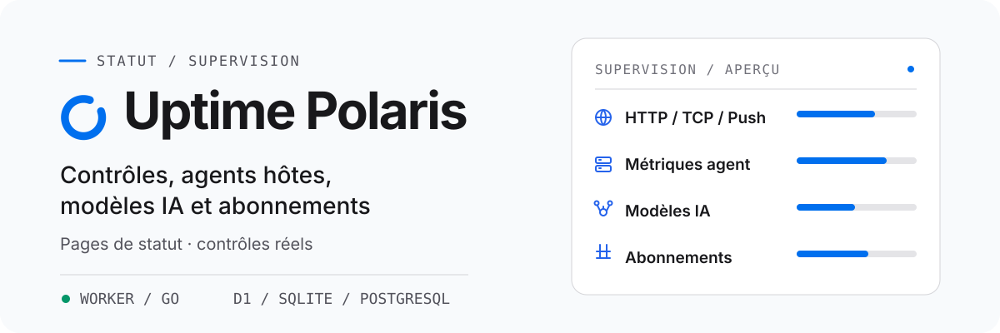

<div align="center">

<picture>
  <source media="(prefers-color-scheme: dark)" srcset="assets/readme/overview-fr-FR-dark.svg">
  <source media="(prefers-color-scheme: light)" srcset="assets/readme/overview-fr-FR-light.svg">
  
</picture>

<a href="README.md">English</a> · <a href="README-zh-CN.md">简体中文</a> · <a href="README-zh-TW.md">繁體中文（台灣）</a> · <a href="README-zh-HK.md">繁體中文（香港）</a> · <a href="README-ja-JP.md">日本語</a> · <a href="README-ko-KR.md">한국어</a> · <strong>Français</strong> · <a href="README-pt-BR.md">Português (Brasil)</a> · <a href="README-ru-RU.md">Русский</a>

# Uptime Polaris

Supervision et page de statut auto-hébergées tout-en-un : contrôles de disponibilité, agents hôtes, supervision de modèles IA et abonnements à des statuts publics au même endroit.<br>
Fonctionne sur Cloudflare Workers ou avec un backend Go, avec une page de statut publique et une console d'administration, en 9 langues.

<p>
  <a href="https://developers.cloudflare.com/workers/"></a>
  <a href="backends/go/README.md"></a>
  <a href="frontend/README.md"></a>
  <a href="https://github.com/XingLingQAQ/Polaris-Agent"></a>
  <a href="docs/configuration.md"></a>
</p>

<p><a href="#fonctionnalités">Fonctionnalités</a> · <a href="#backend">Backend</a> · <a href="#déploiement-rapide">Déploiement</a> · <a href="#agent-hôte">Agent</a> · <a href="#documentation">Documentation</a></p>

</div>

## Fonctionnalités

- **Contrôles de disponibilité et battements de cœur** : HTTP, TCP et battements Push, avec vérification facultative du certificat SSL, de l'expiration du domaine et des enregistrements DNS. Le backend Go sonde aussi nativement UDP, ICMP, DNS, TLS et WebSocket, et les services internes peuvent être contrôlés via un agent.
- **Supervision par abonnement** : abonnez-vous aux statuts publics de sites web et de modèles publiés par d'autres sites et rassemblez-les sur votre page. Le [dépôt officiel d'abonnements](https://github.com/XingLingQAQ/UptimePolaris-Subscriptions) fournit des modèles pour Uptime Kuma, Polaris, Statuspage et JSON ; les dépôts tiers et les descripteurs JSON personnalisés sont également pris en charge.
- **Agent hôte** : [polaris-agent](https://github.com/XingLingQAQ/Polaris-Agent) est un agent Rust léger pour Linux, macOS, Windows et Docker. Il remonte le CPU, la mémoire, le disque, la charge et le réseau, avec alertes sur seuil et comparaison de machines.
- **Supervision de modèles IA** : protocoles OpenAI Chat Completions, OpenAI Responses, Anthropic Messages et Gemini, y compris les passerelles et les modèles locaux. Importez des modèles depuis un canal, envoyez des paramètres personnalisés et publiez une page dédiée.
- **Plusieurs pages publiques et thèmes** : une page de supervision (`/`), une page machines (`/servers`) et une page de modèles IA (`/ai`), chacune activable, associable à son propre domaine, basculée en maintenance et personnalisable par un thème tiers.
- **Notifications multi-canaux** : Telegram, Feishu, Slack, Discord, Webhook, Apprise et ServerChan, routées par règles globales ou par sélection explicite, avec des messages en 9 langues.

## Backend

Les deux backends partagent la même interface et la console `/admin` ; choisissez selon votre environnement.

| | Cloudflare Worker | Go |
| --- | --- | --- |
| Exécution | Cloudflare Workers | Serveur personnel / Docker |
| Base de données | D1 ou PostgreSQL | SQLite ou PostgreSQL |
| Protocoles sondés directement | HTTP, TCP (UDP et ICMP via un agent) | HTTP, TCP, UDP, ICMP, DNS, TLS, WebSocket |
| Intervalle minimal | 60 secondes | 5 secondes |
| Répartition à grande échelle | Cloudflare Queue en option | Ordonnanceur interne |
| Stockage des thèmes | R2 (facultatif) | Répertoire de données local |

La comparaison complète se trouve dans [les options de backend](docs/backends.md).

## Déploiement rapide

### Cloudflare Workers

1. Forkez ce dépôt, puis importez-le dans la console Cloudflare via **Workers & Pages → Create application → GitHub**, avec `npm run build` comme commande de construction et `npm run deploy` comme commande de déploiement.
2. Ouvrez `/setup` après le déploiement et suivez les vérifications pour ajouter la configuration requise dans les **Settings** du Worker :
   - Liaison KV `CONFIG`
   - Liaison Analytics Engine `UPTIME`
   - Secret `ADMIN_TOKEN` (une longue chaîne aléatoire)
   - Facultatif : liaison D1 `DB` (PostgreSQL est utilisé en son absence), liaison R2 `THEMES` (thèmes tiers), liaison Queue `CHECK_QUEUE` (contrôles répartis)
3. Revenez sur `/setup` pour vérifier la base de données et créer l'administrateur.

Vous pouvez aussi déployer avec le bouton ci-dessous, qui crée un dépôt distinct plutôt qu'un fork :

[](https://deploy.workers.cloudflare.com/?url=https://github.com/XingLingQAQ/UptimePolaris)

Le déploiement manuel, les domaines personnalisés et la migration vers PostgreSQL sont décrits dans le [guide de déploiement](docs/deployment.md).

### Go auto-hébergé

Téléchargez la version correspondant à votre plateforme depuis [Releases](https://github.com/XingLingQAQ/UptimePolaris/releases) et démarrez-la :

```sh
chmod +x polaris   # Linux / macOS
./polaris --data-dir ./data
```

```powershell
.\polaris.exe --data-dir .\data
```

Il écoute sur `127.0.0.1:8080` par défaut. Ouvrez `/setup` et utilisez la clé d'initialisation du champ `setup_key` du journal de démarrage pour créer l'administrateur. Le déploiement Docker peut partir de [`backends/go/compose.yaml`](backends/go/compose.yaml) ; les options, variables d'environnement et mises à jour gérées sont dans le [guide du backend Go](backends/go/README.md).

## Agent hôte

Connectez-vous à `/admin`, ouvrez **Gestion des agents** et ajoutez une machine. Copiez la commande d'installation de sa plateforme, exécutez-la sur la machine, puis gérez le service avec `pa` :

```sh
pa status
pa restart
pa logs -f
pa update
```

La configuration, les commandes distantes et la désinstallation sont dans le [guide de l'agent](docs/agents.md).

## Documentation

| Document | Contenu |
| --- | --- |
| [Options de backend](docs/backends.md) | Comparaison des capacités Worker et Go |
| [Déploiement](docs/deployment.md) | Configuration Cloudflare, domaines, PostgreSQL et migration D1 |
| [Backend Go](backends/go/README.md) | Options, Docker, mises à jour gérées et migration des données |
| [Utilisation](docs/usage.md) | Configuration des contrôles, battements Push, pages publiques, maintenance et sécurité |
| [Abonnements](docs/subscriptions.md) | Dépôts d'abonnements, descripteurs personnalisés et synchronisation |
| [Supervision IA](docs/ai-monitoring.md) | Protocoles des canaux, import groupé, pages de modèles et gestion des clés |
| [Agent](docs/agents.md) | Installation, gestion, configuration et désinstallation |
| [Notifications](docs/notifications.md) | Canaux, règles de routage et historiques d'envoi |
| [Worker Queue](docs/queue.md) | Contrôles répartis sur Workers |
| [Thèmes](docs/themes.md) | Installation, configuration et développement de thèmes tiers |
| [Configuration](docs/configuration.md) | Liaisons, variables d'environnement et réglages de la console |
| [API](docs/api.md) | Points d'accès et authentification |
| [Exploitation](docs/operations.md) | Mises à niveau, sauvegarde et restauration, rétention |
| [Dépannage](docs/troubleshooting.md) | Diagnostic des pannes |

## Liens

[LinuxDo](https://linux.do/)

## Licence

Publié sous [licence MIT](LICENSE).
