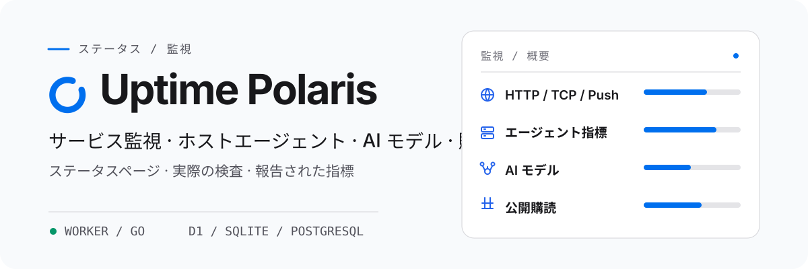

<div align="center">

<picture>
  <source media="(prefers-color-scheme: dark)" srcset="assets/readme/overview-ja-JP-dark.svg">
  <source media="(prefers-color-scheme: light)" srcset="assets/readme/overview-ja-JP-light.svg">
  
</picture>

<a href="README.md">English</a> · <a href="README-zh-CN.md">简体中文</a> · <a href="README-zh-TW.md">繁體中文（台灣）</a> · <a href="README-zh-HK.md">繁體中文（香港）</a> · <strong>日本語</strong> · <a href="README-ko-KR.md">한국어</a> · <a href="README-fr-FR.md">Français</a> · <a href="README-pt-BR.md">Português (Brasil)</a> · <a href="README-ru-RU.md">Русский</a>

# Uptime Polaris

サービス監視・ホストエージェント・AI モデル監視・公開ステータス購読を 1 つにまとめた、セルフホスト型の監視とステータスページです。<br>
Cloudflare Workers と Go の両バックエンドに対応し、公開ステータスページと管理コンソールを備え、9 言語のインターフェースを提供します。

<p>
  <a href="https://developers.cloudflare.com/workers/"></a>
  <a href="backends/go/README.md"></a>
  <a href="frontend/README.md"></a>
  <a href="https://github.com/XingLingQAQ/Polaris-Agent"></a>
  <a href="docs/configuration.md"></a>
</p>

<p><a href="#機能">機能</a> · <a href="#バックエンド">バックエンド</a> · <a href="#クイックデプロイ">デプロイ</a> · <a href="#ホストエージェント">エージェント</a> · <a href="#ドキュメント">ドキュメント</a></p>

</div>

## 機能

- **稼働監視とハートビート**：HTTP、TCP、Push ハートビートに対応し、SSL 証明書・ドメイン有効期限・DNS の追加検査も行えます。Go バックエンドは UDP、ICMP、DNS、TLS、WebSocket をネイティブに検査でき、社内サービスはエージェント経由で監視できます。
- **購読による監視の拡張**：他サイトが公開しているウェブサイトとモデルの状態を購読し、自分のページにまとめて表示できます。[公式購読リポジトリ](https://github.com/XingLingQAQ/UptimePolaris-Subscriptions)には Uptime Kuma、Polaris、Statuspage、JSON のテンプレートがあり、サードパーティのリポジトリや独自の JSON 記述ファイルも利用できます。
- **ホストエージェント**：Rust 製の軽量エージェント [polaris-agent](https://github.com/XingLingQAQ/Polaris-Agent)（Linux / macOS / Windows / Docker 対応）が CPU、メモリ、ディスク、負荷、ネットワークを収集します。リソースしきい値のアラートとマシン比較にも対応します。
- **AI モデル監視**：OpenAI Chat Completions、OpenAI Responses、Anthropic Messages、Gemini の各プロトコルに対応し、中継ゲートウェイとローカルモデルも利用できます。モデルの一括取り込み、独自のリクエストパラメータ、専用の公開ページを備えます。
- **複数の公開ページとテーマ**：監視ページ（`/`）、マシンページ（`/servers`）、AI モデルページ（`/ai`）を個別に有効化し、専用ドメインの割り当て、メンテナンス中の切り替え、サードパーティテーマの適用ができます。
- **多チャンネル通知**：Telegram、飛書、Slack、Discord、Webhook、Apprise、Server酱に対応します。全体ルールまたはチャンネル指定で振り分け、メッセージは 9 言語に対応します。

## バックエンド

どちらのバックエンドも同じフロントエンドと `/admin` コンソールを使います。環境に合わせて選んでください。

| | Cloudflare Worker | Go |
| --- | --- | --- |
| 実行環境 | Cloudflare Workers | 自前のサーバー / Docker |
| データベース | D1 または PostgreSQL | SQLite または PostgreSQL |
| 直接検査できるプロトコル | HTTP、TCP（UDP と ICMP はエージェント経由） | HTTP、TCP、UDP、ICMP、DNS、TLS、WebSocket |
| 最短の検査間隔 | 60 秒 | 5 秒 |
| 大規模な分割実行 | 任意で Cloudflare Queue | プロセス内スケジューラ |
| テーマの保存先 | R2（任意） | ローカルのデータディレクトリ |

詳しい比較は[バックエンドの選択](docs/backends.md)にあります。

## クイックデプロイ

### Cloudflare Workers

1. このリポジトリをフォークし、Cloudflare コンソールの **Workers & Pages → Create application → GitHub** から取り込みます。ビルドコマンドは `npm run build`、デプロイコマンドは `npm run deploy` です。
2. デプロイ後に `/setup` を開き、ページのチェックに従って Worker の **Settings** で必要な設定を追加します。
   - KV バインディング `CONFIG`
   - Analytics Engine バインディング `UPTIME`
   - Secret `ADMIN_TOKEN`（長いランダム文字列）
   - 任意：D1 バインディング `DB`（未設定なら PostgreSQL を使用）、R2 バインディング `THEMES`（サードパーティテーマ）、Queue バインディング `CHECK_QUEUE`（分割検査）
3. `/setup` に戻り、データベースの検証と管理者の作成を完了します。

下のボタンからもデプロイできます。フォークではなく独立したリポジトリが作成されます。

[](https://deploy.workers.cloudflare.com/?url=https://github.com/XingLingQAQ/UptimePolaris)

手動デプロイ、独自ドメイン、PostgreSQL への移行は[デプロイガイド](docs/deployment.md)を参照してください。

### Go のセルフホスト

[Releases](https://github.com/XingLingQAQ/UptimePolaris/releases) から環境に合ったビルドを取得して起動します。

```sh
chmod +x polaris   # Linux / macOS
./polaris --data-dir ./data
```

```powershell
.\polaris.exe --data-dir .\data
```

既定では `127.0.0.1:8080` を待ち受けます。`/setup` を開き、起動ログの `setup_key` フィールドにある初期化キーで管理者を作成してください。Docker では [`backends/go/compose.yaml`](backends/go/compose.yaml) をそのまま利用できます。起動フラグ、環境変数、管理画面からの更新は [Go バックエンドガイド](backends/go/README.md)にあります。

## ホストエージェント

`/admin` にサインインし、**エージェント管理**でマシンを追加します。プラットフォームごとのインストールコマンドをコピーして対象マシンで実行し、以降は `pa` で管理します。

```sh
pa status
pa restart
pa logs -f
pa update
```

設定、リモートコマンド、アンインストールは[エージェントガイド](docs/agents.md)を参照してください。

## ドキュメント

| ドキュメント | 内容 |
| --- | --- |
| [バックエンドの選択](docs/backends.md) | Worker と Go の機能比較 |
| [デプロイ](docs/deployment.md) | Cloudflare の設定、ドメイン、PostgreSQL と D1 の移行 |
| [Go バックエンド](backends/go/README.md) | 起動フラグ、Docker、管理画面からの更新、データ移行 |
| [使い方](docs/usage.md) | 監視の設定、Push ハートビート、公開ページ、メンテナンス、セキュリティ |
| [購読](docs/subscriptions.md) | 購読リポジトリ、独自の記述ファイル、同期 |
| [AI モデル監視](docs/ai-monitoring.md) | チャンネルのプロトコル、一括取り込み、公開ページ、鍵の管理 |
| [エージェント](docs/agents.md) | インストール、管理、設定、削除 |
| [通知](docs/notifications.md) | チャンネル、振り分けルール、配信記録 |
| [Worker Queue](docs/queue.md) | Worker での分割検査 |
| [テーマ](docs/themes.md) | サードパーティテーマのインストール、設定、開発 |
| [設定](docs/configuration.md) | バインディング、環境変数、コンソール設定 |
| [API](docs/api.md) | エンドポイントと認証 |
| [運用](docs/operations.md) | アップグレード、バックアップと復元、保存期間 |
| [トラブルシューティング](docs/troubleshooting.md) | 障害の切り分け |

## リンク

[LinuxDo](https://linux.do/)

## ライセンス

[MIT ライセンス](LICENSE)で公開しています。
