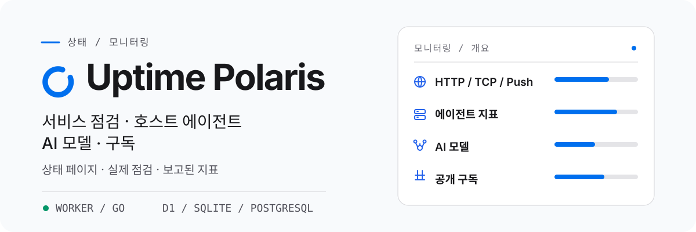

<div align="center">

<picture>
  <source media="(prefers-color-scheme: dark)" srcset="assets/readme/overview-ko-KR-dark.svg">
  <source media="(prefers-color-scheme: light)" srcset="assets/readme/overview-ko-KR-light.svg">
  
</picture>

<a href="README.md">English</a> · <a href="README-zh-CN.md">简体中文</a> · <a href="README-zh-TW.md">繁體中文（台灣）</a> · <a href="README-zh-HK.md">繁體中文（香港）</a> · <a href="README-ja-JP.md">日本語</a> · <strong>한국어</strong> · <a href="README-fr-FR.md">Français</a> · <a href="README-pt-BR.md">Português (Brasil)</a> · <a href="README-ru-RU.md">Русский</a>

# Uptime Polaris

서비스 점검, 호스트 에이전트, AI 모델 모니터링, 공개 상태 구독을 하나로 묶은 셀프 호스팅 모니터링 및 상태 페이지입니다.<br>
Cloudflare Workers와 Go 백엔드를 모두 지원하며, 공개 상태 페이지와 관리 콘솔, 9개 언어 인터페이스를 제공합니다.

<p>
  <a href="https://developers.cloudflare.com/workers/"></a>
  <a href="backends/go/README.md"></a>
  <a href="frontend/README.md"></a>
  <a href="https://github.com/XingLingQAQ/Polaris-Agent"></a>
  <a href="docs/configuration.md"></a>
</p>

<p><a href="#기능">기능</a> · <a href="#백엔드-선택">백엔드</a> · <a href="#빠른-배포">배포</a> · <a href="#호스트-에이전트">에이전트</a> · <a href="#문서">문서</a></p>

</div>

## 기능

- **가동 점검과 하트비트**: HTTP, TCP, Push 하트비트를 지원하며 SSL 인증서, 도메인 만료, DNS 점검을 덧붙일 수 있습니다. Go 백엔드는 UDP, ICMP, DNS, TLS, WebSocket을 기본으로 점검하고, 내부 서비스는 에이전트를 통해 확인할 수 있습니다.
- **구독으로 감시 확장**: 다른 사이트가 공개한 웹사이트와 모델 상태를 구독해 내 페이지에 모아 보여 줍니다. [공식 구독 저장소](https://github.com/XingLingQAQ/UptimePolaris-Subscriptions)에 Uptime Kuma, Polaris, Statuspage, JSON 템플릿이 있으며, 서드파티 저장소나 직접 만든 JSON 서술 파일도 쓸 수 있습니다.
- **호스트 에이전트**: Rust로 작성된 가벼운 에이전트 [polaris-agent](https://github.com/XingLingQAQ/Polaris-Agent)(Linux / macOS / Windows / Docker 지원)가 CPU, 메모리, 디스크, 부하, 네트워크를 수집합니다. 자원 임계값 경고와 머신 비교도 지원합니다.
- **AI 모델 모니터링**: OpenAI Chat Completions, OpenAI Responses, Anthropic Messages, Gemini 프로토콜을 지원하며 중계 게이트웨이와 로컬 모델도 사용할 수 있습니다. 모델 일괄 가져오기, 사용자 지정 요청 매개변수, 전용 공개 페이지를 제공합니다.
- **여러 공개 페이지와 테마**: 모니터 페이지(`/`), 머신 페이지(`/servers`), AI 모델 페이지(`/ai`)를 각각 켜고 끄고, 별도 도메인을 연결하고, 점검 시간에 전환하며, 서드파티 테마를 적용할 수 있습니다.
- **다채널 알림**: Telegram, Feishu, Slack, Discord, Webhook, Apprise, Server酱를 지원합니다. 전체 규칙이나 채널 지정으로 분배하며 메시지는 9개 언어를 지원합니다.

## 백엔드 선택

두 백엔드는 같은 프런트엔드와 `/admin` 콘솔을 사용합니다. 환경에 맞는 쪽을 고르세요.

| | Cloudflare Worker | Go |
| --- | --- | --- |
| 실행 환경 | Cloudflare Workers | 자체 서버 / Docker |
| 데이터베이스 | D1 또는 PostgreSQL | SQLite 또는 PostgreSQL |
| 직접 점검 프로토콜 | HTTP, TCP(UDP와 ICMP는 에이전트 경유) | HTTP, TCP, UDP, ICMP, DNS, TLS, WebSocket |
| 최단 점검 간격 | 60초 | 5초 |
| 대규모 분할 실행 | 선택 사항인 Cloudflare Queue | 프로세스 내 스케줄러 |
| 테마 저장소 | R2(선택) | 로컬 데이터 디렉터리 |

자세한 비교는 [백엔드 선택](docs/backends.md)에 있습니다.

## 빠른 배포

### Cloudflare Workers

1. 이 저장소를 포크한 뒤 Cloudflare 콘솔의 **Workers & Pages → Create application → GitHub**에서 가져옵니다. 빌드 명령은 `npm run build`, 배포 명령은 `npm run deploy`입니다.
2. 배포 후 `/setup`을 열고 페이지의 점검 안내에 따라 Worker의 **Settings**에 필요한 설정을 추가합니다.
   - KV 바인딩 `CONFIG`
   - Analytics Engine 바인딩 `UPTIME`
   - Secret `ADMIN_TOKEN`(긴 무작위 문자열)
   - 선택: D1 바인딩 `DB`(없으면 PostgreSQL 사용), R2 바인딩 `THEMES`(서드파티 테마), Queue 바인딩 `CHECK_QUEUE`(분할 점검)
3. `/setup`으로 돌아와 데이터베이스 검증과 관리자 생성을 마칩니다.

아래 버튼으로도 배포할 수 있습니다. 포크가 아니라 별도 저장소가 만들어집니다.

[](https://deploy.workers.cloudflare.com/?url=https://github.com/XingLingQAQ/UptimePolaris)

수동 배포, 사용자 지정 도메인, PostgreSQL 이전은 [배포 가이드](docs/deployment.md)를 참고하세요.

### Go 직접 호스팅

[Releases](https://github.com/XingLingQAQ/UptimePolaris/releases)에서 플랫폼에 맞는 빌드를 받아 실행합니다.

```sh
chmod +x polaris   # Linux / macOS
./polaris --data-dir ./data
```

```powershell
.\polaris.exe --data-dir .\data
```

기본값은 `127.0.0.1:8080`입니다. `/setup`을 열고 시작 로그의 `setup_key` 필드에 있는 초기화 키로 관리자를 만드세요. Docker는 [`backends/go/compose.yaml`](backends/go/compose.yaml)을 그대로 쓸 수 있습니다. 실행 인자, 환경 변수, 콘솔에서의 업데이트는 [Go 백엔드 안내](backends/go/README.md)에 있습니다.

## 호스트 에이전트

`/admin`에 로그인해 **에이전트 관리**에서 머신을 추가합니다. 플랫폼별 설치 명령을 복사해 대상 머신에서 실행하고, 이후에는 `pa`로 관리합니다.

```sh
pa status
pa restart
pa logs -f
pa update
```

설정, 원격 명령, 제거 방법은 [에이전트 안내](docs/agents.md)를 참고하세요.

## 문서

| 문서 | 내용 |
| --- | --- |
| [백엔드 선택](docs/backends.md) | Worker와 Go 기능 비교 |
| [배포](docs/deployment.md) | Cloudflare 설정, 도메인, PostgreSQL과 D1 이전 |
| [Go 백엔드](backends/go/README.md) | 실행 인자, Docker, 콘솔 업데이트, 데이터 이전 |
| [사용법](docs/usage.md) | 모니터 설정, Push 하트비트, 공개 페이지, 점검 시간, 보안 |
| [구독](docs/subscriptions.md) | 구독 저장소, 직접 만든 서술 파일, 동기화 |
| [AI 모델 모니터링](docs/ai-monitoring.md) | 채널 프로토콜, 일괄 가져오기, 공개 페이지, 키 관리 |
| [에이전트](docs/agents.md) | 설치, 관리, 설정, 제거 |
| [알림](docs/notifications.md) | 채널, 분배 규칙, 전송 기록 |
| [Worker Queue](docs/queue.md) | Worker에서의 분할 점검 |
| [테마](docs/themes.md) | 서드파티 테마 설치, 설정, 개발 |
| [설정](docs/configuration.md) | 바인딩, 환경 변수, 콘솔 설정 |
| [API](docs/api.md) | 엔드포인트와 인증 |
| [운영](docs/operations.md) | 업그레이드, 백업과 복원, 보존 |
| [문제 해결](docs/troubleshooting.md) | 장애 진단 |

## 링크

[LinuxDo](https://linux.do/)

## 라이선스

[MIT 라이선스](LICENSE)로 배포됩니다.
