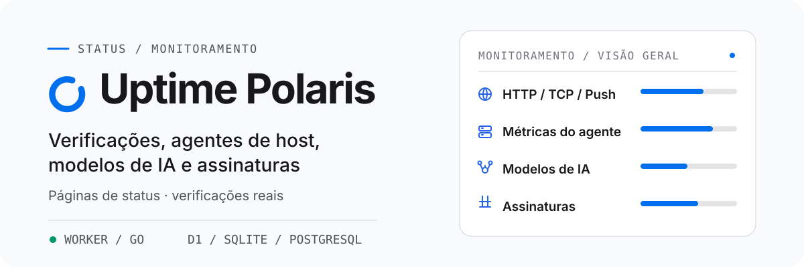

<div align="center">

<picture>
  <source media="(prefers-color-scheme: dark)" srcset="assets/readme/overview-pt-BR-dark.svg">
  <source media="(prefers-color-scheme: light)" srcset="assets/readme/overview-pt-BR-light.svg">
  
</picture>

<a href="README.md">English</a> · <a href="README-zh-CN.md">简体中文</a> · <a href="README-zh-TW.md">繁體中文（台灣）</a> · <a href="README-zh-HK.md">繁體中文（香港）</a> · <a href="README-ja-JP.md">日本語</a> · <a href="README-ko-KR.md">한국어</a> · <a href="README-fr-FR.md">Français</a> · <strong>Português (Brasil)</strong> · <a href="README-ru-RU.md">Русский</a>

# Uptime Polaris

Monitoramento e página de status auto-hospedados em um só lugar: verificações de disponibilidade, agentes de host, monitoramento de modelos de IA e assinaturas de status públicos.<br>
Roda em Cloudflare Workers ou com um backend Go, com página de status pública e console administrativo, em 9 idiomas.

<p>
  <a href="https://developers.cloudflare.com/workers/"></a>
  <a href="backends/go/README.md"></a>
  <a href="frontend/README.md"></a>
  <a href="https://github.com/XingLingQAQ/Polaris-Agent"></a>
  <a href="docs/configuration.md"></a>
</p>

<p><a href="#recursos">Recursos</a> · <a href="#backends">Backends</a> · <a href="#implantação-rápida">Implantação</a> · <a href="#agente-de-host">Agente</a> · <a href="#documentação">Documentação</a></p>

</div>

## Recursos

- **Verificações e heartbeats**: HTTP, TCP e heartbeats Push, com verificação opcional de certificado SSL, expiração de domínio e registros DNS. O backend Go também sonda UDP, ICMP, DNS, TLS e WebSocket nativamente, e serviços internos podem ser verificados por um agente.
- **Monitoramento por assinatura**: assine status públicos de sites e modelos publicados por outros sites e reúna tudo na sua página. O [repositório oficial de assinaturas](https://github.com/XingLingQAQ/UptimePolaris-Subscriptions) traz modelos para Uptime Kuma, Polaris, Statuspage e JSON; repositórios de terceiros e descritores JSON próprios também são aceitos.
- **Agente de host**: [polaris-agent](https://github.com/XingLingQAQ/Polaris-Agent) é um agente leve em Rust para Linux, macOS, Windows e Docker. Ele reporta CPU, memória, disco, carga e rede, com alertas por limite de recurso e comparação entre máquinas.
- **Monitoramento de modelos de IA**: protocolos OpenAI Chat Completions, OpenAI Responses, Anthropic Messages e Gemini, incluindo gateways e modelos locais. Importe modelos de um canal, envie parâmetros personalizados e publique uma página dedicada.
- **Várias páginas públicas e temas**: página de monitores (`/`), página de máquinas (`/servers`) e página de modelos de IA (`/ai`), cada uma ativável, vinculável a um domínio próprio, alternada para manutenção e personalizável com temas de terceiros.
- **Notificações em vários canais**: Telegram, Feishu, Slack, Discord, Webhook, Apprise e ServerChan, roteadas por regras globais ou seleção explícita, com mensagens em 9 idiomas.

## Backends

Os dois backends compartilham a mesma interface e o console `/admin`; escolha conforme o ambiente.

| | Cloudflare Worker | Go |
| --- | --- | --- |
| Execução | Cloudflare Workers | Servidor próprio / Docker |
| Banco de dados | D1 ou PostgreSQL | SQLite ou PostgreSQL |
| Protocolos sondados diretamente | HTTP, TCP (UDP e ICMP via agente) | HTTP, TCP, UDP, ICMP, DNS, TLS, WebSocket |
| Intervalo mínimo | 60 segundos | 5 segundos |
| Distribuição em lote | Cloudflare Queue opcional | Agendador no processo |
| Armazenamento de temas | R2 (opcional) | Diretório de dados local |

A comparação completa está em [opções de backend](docs/backends.md).

## Implantação rápida

### Cloudflare Workers

1. Faça um fork deste repositório e importe-o no console da Cloudflare em **Workers & Pages → Create application → GitHub**, usando `npm run build` como comando de build e `npm run deploy` como comando de deploy.
2. Abra `/setup` após a implantação e siga as verificações para adicionar a configuração necessária em **Settings** do Worker:
   - Bind de KV `CONFIG`
   - Bind do Analytics Engine `UPTIME`
   - Secret `ADMIN_TOKEN` (uma string aleatória longa)
   - Opcional: bind D1 `DB` (PostgreSQL é usado na ausência dele), bind R2 `THEMES` (temas de terceiros), bind de Queue `CHECK_QUEUE` (verificações em lote)
3. Volte a `/setup` para validar o banco de dados e criar o administrador.

Você também pode implantar pelo botão abaixo, que cria um repositório separado em vez de um fork:

[](https://deploy.workers.cloudflare.com/?url=https://github.com/XingLingQAQ/UptimePolaris)

Implantação manual, domínios personalizados e migração para PostgreSQL estão no [guia de implantação](docs/deployment.md).

### Go auto-hospedado

Baixe a versão da sua plataforma em [Releases](https://github.com/XingLingQAQ/UptimePolaris/releases) e inicie:

```sh
chmod +x polaris   # Linux / macOS
./polaris --data-dir ./data
```

```powershell
.\polaris.exe --data-dir .\data
```

Ele escuta em `127.0.0.1:8080` por padrão. Abra `/setup` e use a chave de inicialização do campo `setup_key` no log de inicialização para criar o administrador. A implantação com Docker pode partir de [`backends/go/compose.yaml`](backends/go/compose.yaml); flags, variáveis de ambiente e atualizações gerenciadas estão no [guia do backend Go](backends/go/README.md).

## Agente de host

Entre em `/admin`, abra **Gerenciamento de agentes** e adicione uma máquina. Copie o comando de instalação da plataforma, execute-o na máquina e gerencie o serviço com `pa`:

```sh
pa status
pa restart
pa logs -f
pa update
```

Configuração, comandos remotos e remoção estão no [guia do agente](docs/agents.md).

## Documentação

| Documento | Conteúdo |
| --- | --- |
| [Opções de backend](docs/backends.md) | Comparação entre Worker e Go |
| [Implantação](docs/deployment.md) | Configuração da Cloudflare, domínios, PostgreSQL e migração do D1 |
| [Backend Go](backends/go/README.md) | Flags, Docker, atualizações gerenciadas e migração de dados |
| [Uso](docs/usage.md) | Configuração de monitores, heartbeats Push, páginas públicas, manutenção e segurança |
| [Assinaturas](docs/subscriptions.md) | Repositórios de assinatura, descritores próprios e sincronização |
| [Monitoramento de IA](docs/ai-monitoring.md) | Protocolos de canal, importação em lote, páginas de modelos e gerenciamento de chaves |
| [Agente](docs/agents.md) | Instalação, gerenciamento, configuração e remoção |
| [Notificações](docs/notifications.md) | Canais, regras de roteamento e registros de entrega |
| [Worker Queue](docs/queue.md) | Verificações em lote no Workers |
| [Temas](docs/themes.md) | Instalação, configuração e desenvolvimento de temas de terceiros |
| [Configuração](docs/configuration.md) | Binds, variáveis de ambiente e ajustes do console |
| [API](docs/api.md) | Endpoints e autenticação |
| [Operações](docs/operations.md) | Atualizações, backup e restauração, retenção |
| [Solução de problemas](docs/troubleshooting.md) | Diagnóstico de falhas |

## Links

[LinuxDo](https://linux.do/)

## Licença

Distribuído sob a [licença MIT](LICENSE).
