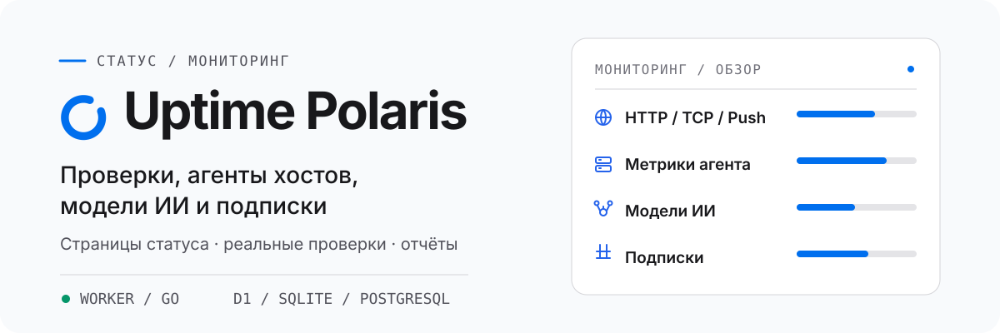

<div align="center">

<picture>
  <source media="(prefers-color-scheme: dark)" srcset="assets/readme/overview-ru-RU-dark.svg">
  <source media="(prefers-color-scheme: light)" srcset="assets/readme/overview-ru-RU-light.svg">
  
</picture>

<a href="README.md">English</a> · <a href="README-zh-CN.md">简体中文</a> · <a href="README-zh-TW.md">繁體中文（台灣）</a> · <a href="README-zh-HK.md">繁體中文（香港）</a> · <a href="README-ja-JP.md">日本語</a> · <a href="README-ko-KR.md">한국어</a> · <a href="README-fr-FR.md">Français</a> · <a href="README-pt-BR.md">Português (Brasil)</a> · <strong>Русский</strong>

# Uptime Polaris

Самостоятельно размещаемый мониторинг и страница статуса в одном решении: проверки доступности, агенты хостов, мониторинг моделей ИИ и подписки на публичные статусы.<br>
Работает на Cloudflare Workers или на бэкенде Go, с публичной страницей статуса и консолью администратора, на 9 языках.

<p>
  <a href="https://developers.cloudflare.com/workers/"></a>
  <a href="backends/go/README.md"></a>
  <a href="frontend/README.md"></a>
  <a href="https://github.com/XingLingQAQ/Polaris-Agent"></a>
  <a href="docs/configuration.md"></a>
</p>

<p><a href="#возможности">Возможности</a> · <a href="#бэкенды">Бэкенды</a> · <a href="#быстрое-развёртывание">Развёртывание</a> · <a href="#агент-хоста">Агент</a> · <a href="#документация">Документация</a></p>

</div>

## Возможности

- **Проверки доступности и heartbeat**: HTTP, TCP и пассивные heartbeat-сигналы Push, с дополнительной проверкой сертификата SSL, срока домена и записей DNS. Бэкенд Go также напрямую проверяет UDP, ICMP, DNS, TLS и WebSocket, а внутренние сервисы можно проверять через агент.
- **Мониторинг по подписке**: подпишитесь на публичные статусы сайтов и моделей других проектов и соберите их на своей странице. В [официальном репозитории подписок](https://github.com/XingLingQAQ/UptimePolaris-Subscriptions) есть шаблоны для Uptime Kuma, Polaris, Statuspage и JSON; поддерживаются сторонние репозитории и собственные JSON-описания.
- **Агент хоста**: [polaris-agent](https://github.com/XingLingQAQ/Polaris-Agent) — небольшой агент на Rust для Linux, macOS, Windows и Docker. Он передаёт CPU, память, диск, нагрузку и сеть, поддерживает оповещения по порогам ресурсов и сравнение машин.
- **Мониторинг моделей ИИ**: протоколы OpenAI Chat Completions, OpenAI Responses, Anthropic Messages и Gemini, включая шлюзы и локальные модели. Импорт моделей из канала, собственные параметры запроса и отдельная публичная страница.
- **Несколько публичных страниц и темы**: страница мониторов (`/`), страница машин (`/servers`) и страница моделей ИИ (`/ai`). Каждую можно включить отдельно, привязать к своему домену, переключать на страницу обслуживания и оформлять сторонними темами.
- **Уведомления по многим каналам**: Telegram, Feishu, Slack, Discord, Webhook, Apprise и ServerChan с маршрутизацией по общим правилам или явным выбором каналов; сообщения на 9 языках.

## Бэкенды

Оба бэкенда используют один интерфейс и консоль `/admin`; выберите подходящий для вашей среды.

| | Cloudflare Worker | Go |
| --- | --- | --- |
| Среда выполнения | Cloudflare Workers | Собственный сервер / Docker |
| База данных | D1 или PostgreSQL | SQLite или PostgreSQL |
| Протоколы прямой проверки | HTTP, TCP (UDP и ICMP через агент) | HTTP, TCP, UDP, ICMP, DNS, TLS, WebSocket |
| Минимальный интервал | 60 секунд | 5 секунд |
| Распределение при большой нагрузке | Cloudflare Queue по желанию | Планировщик внутри процесса |
| Хранение тем | R2 (необязательно) | Локальный каталог данных |

Полное сравнение — в разделе [выбор бэкенда](docs/backends.md).

## Быстрое развёртывание

### Cloudflare Workers

1. Сделайте форк репозитория и импортируйте его в консоли Cloudflare через **Workers & Pages → Create application → GitHub**, указав `npm run build` как команду сборки и `npm run deploy` как команду развёртывания.
2. После развёртывания откройте `/setup` и, следуя проверкам, добавьте нужные настройки в разделе **Settings** воркера:
   - Привязка KV `CONFIG`
   - Привязка Analytics Engine `UPTIME`
   - Секрет `ADMIN_TOKEN` (длинная случайная строка)
   - Необязательно: привязка D1 `DB` (без неё используется PostgreSQL), привязка R2 `THEMES` (сторонние темы), привязка Queue `CHECK_QUEUE` (пакетные проверки)
3. Вернитесь на `/setup`, проверьте базу данных и создайте администратора.

Можно развернуть и кнопкой ниже — она создаёт отдельный репозиторий, а не форк:

[](https://deploy.workers.cloudflare.com/?url=https://github.com/XingLingQAQ/UptimePolaris)

Ручное развёртывание, собственные домены и перенос на PostgreSQL описаны в [руководстве по развёртыванию](docs/deployment.md).

### Самостоятельный Go

Скачайте сборку для своей платформы из [Releases](https://github.com/XingLingQAQ/UptimePolaris/releases) и запустите:

```sh
chmod +x polaris   # Linux / macOS
./polaris --data-dir ./data
```

```powershell
.\polaris.exe --data-dir .\data
```

По умолчанию он слушает `127.0.0.1:8080`. Откройте `/setup` и используйте ключ инициализации из поля `setup_key` в журнале запуска, чтобы создать администратора. Для Docker можно взять [`backends/go/compose.yaml`](backends/go/compose.yaml); параметры запуска, переменные среды и обновления из консоли — в [руководстве по бэкенду Go](backends/go/README.md).

## Агент хоста

Войдите в `/admin`, откройте **Управление агентами** и добавьте машину. Скопируйте команду установки для её платформы, выполните на машине, а затем управляйте службой через `pa`:

```sh
pa status
pa restart
pa logs -f
pa update
```

Настройка, удалённые команды и удаление описаны в [руководстве по агенту](docs/agents.md).

## Документация

| Документ | Содержание |
| --- | --- |
| [Выбор бэкенда](docs/backends.md) | Сравнение возможностей Worker и Go |
| [Развёртывание](docs/deployment.md) | Настройка Cloudflare, домены, PostgreSQL и перенос D1 |
| [Бэкенд Go](backends/go/README.md) | Параметры запуска, Docker, обновления и перенос данных |
| [Использование](docs/usage.md) | Настройка мониторов, heartbeat Push, публичные страницы, обслуживание и безопасность |
| [Подписки](docs/subscriptions.md) | Репозитории подписок, собственные описания и синхронизация |
| [Мониторинг ИИ](docs/ai-monitoring.md) | Протоколы каналов, пакетный импорт, страницы моделей и управление ключами |
| [Агент](docs/agents.md) | Установка, управление, настройка и удаление |
| [Уведомления](docs/notifications.md) | Каналы, правила маршрутизации и журналы доставки |
| [Worker Queue](docs/queue.md) | Пакетные проверки на Workers |
| [Темы](docs/themes.md) | Установка, настройка и разработка сторонних тем |
| [Конфигурация](docs/configuration.md) | Привязки, переменные среды и настройки консоли |
| [API](docs/api.md) | Конечные точки и аутентификация |
| [Эксплуатация](docs/operations.md) | Обновления, резервное копирование и хранение |
| [Устранение неполадок](docs/troubleshooting.md) | Диагностика сбоев |

## Ссылки

[LinuxDo](https://linux.do/)

## Лицензия

Распространяется по [лицензии MIT](LICENSE).
