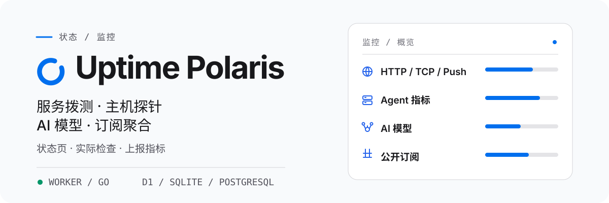

<div align="center">

<picture>
  <source media="(prefers-color-scheme: dark)" srcset="assets/readme/overview-zh-CN-dark.svg">
  <source media="(prefers-color-scheme: light)" srcset="assets/readme/overview-zh-CN-light.svg">
  
</picture>

<a href="README.md">English</a> · <strong>简体中文</strong> · <a href="README-zh-TW.md">繁體中文（台灣）</a> · <a href="README-zh-HK.md">繁體中文（香港）</a> · <a href="README-ja-JP.md">日本語</a> · <a href="README-ko-KR.md">한국어</a> · <a href="README-fr-FR.md">Français</a> · <a href="README-pt-BR.md">Português (Brasil)</a> · <a href="README-ru-RU.md">Русский</a>

# Uptime Polaris

多合一自托管监控与状态页，整合服务拨测、服务器探针、AI 模型监控与公开状态订阅。<br>
支持 Cloudflare Workers 与 Go 双后端，自带公开状态页与管理后台，内置 9 种界面语言。

<p>
  <a href="https://developers.cloudflare.com/workers/"></a>
  <a href="backends/go/README.md"></a>
  <a href="frontend/README.md"></a>
  <a href="https://github.com/XingLingQAQ/Polaris-Agent"></a>
  <a href="docs/configuration.md"></a>
</p>

<p><a href="#功能">功能</a> · <a href="#后端选择">后端选择</a> · <a href="#快速部署">快速部署</a> · <a href="#主机探针">主机探针</a> · <a href="#文档">文档</a></p>

</div>

## 功能

- **服务与心跳监控**：支持 HTTP、TCP 与 Push 被动心跳，可附加 SSL 证书、域名到期与 DNS 检查；Go 后端额外原生支持 UDP、ICMP、DNS、TLS 和 WebSocket，内网服务可交由 Agent 代理探测。
- **可订阅拓展监控**：支持订阅其他站点的公开网站状态与模型状态并汇总展示。默认接入[官方订阅仓库](https://github.com/XingLingQAQ/UptimePolaris-Subscriptions)（内置 Uptime Kuma、Polaris、Statuspage、JSON 等模板），也可添加第三方仓库或导入自定义 JSON 描述文件。
- **主机探针**：配套 Rust 编写的轻量探针 [polaris-agent](https://github.com/XingLingQAQ/Polaris-Agent)（支持 Linux / macOS / Windows 及 Docker），采集 CPU、内存、磁盘、负载、网络等指标，支持资源阈值告警与机器对比。
- **AI 模型监控**：支持 OpenAI Chat Completions、OpenAI Responses、Anthropic Messages 与 Gemini 协议（兼容中转网关与本地模型），支持从渠道导入模型、自定义请求参数与独立展示页。
- **多公开页与主题**：提供监控页（`/`）、机器页（`/servers`）和 AI 模型页（`/ai`），支持按需开关、绑定独立域名、维护窗口切换以及安装第三方主题包。
- **多渠道告警**：支持 Telegram、飞书、Slack、Discord、Webhook、Apprise 和 Server酱，支持按全局规则或指定渠道分发，消息支持 9 种语言。

## 后端选择

两种后端共用同一套前端界面与 `/admin` 管理入口，按部署环境任选其一：

| | Cloudflare Worker | Go |
| --- | --- | --- |
| 运行方式 | Cloudflare Workers | 自有服务器 / Docker |
| 数据库 | D1 或 PostgreSQL | SQLite 或 PostgreSQL |
| 直接探测协议 | HTTP、TCP（UDP、ICMP 通过 Agent） | HTTP、TCP、UDP、ICMP、DNS、TLS、WebSocket |
| 最短检查间隔 | 60 秒 | 5 秒 |
| 大规模分批 | 可选 Cloudflare Queue | 进程内常驻调度 |
| 主题存储 | R2（可选） | 本地数据目录 |

详细区别见[选择后端](docs/backends.md)。

## 快速部署

### Cloudflare Workers

1. Fork 本仓库，在 Cloudflare 控制台通过 **Workers & Pages → Create application → GitHub** 导入，构建命令填 `npm run build`，部署命令填 `npm run deploy`。
2. 部署后访问 `/setup`，按页面检查提示在 Worker 的 **Settings** 中添加必需配置：
   - KV 绑定 `CONFIG`
   - Analytics Engine 绑定 `UPTIME`
   - Secret `ADMIN_TOKEN`（随机长字符串）
   - 可选：D1 绑定 `DB`（不绑则使用 PostgreSQL）、R2 绑定 `THEMES`（第三方主题）、Queue 绑定 `CHECK_QUEUE`（分批检查）
3. 回到 `/setup` 完成数据库验证与管理员初始化。

也可以点击下方按钮直接部署（会新建独立仓库，非 Fork）：

[](https://deploy.workers.cloudflare.com/?url=https://github.com/XingLingQAQ/UptimePolaris)

手动部署、自定义域名与 PostgreSQL 迁移见[部署指南](docs/deployment.md)。

### Go 自托管

从 [Releases](https://github.com/XingLingQAQ/UptimePolaris/releases) 下载对应平台的程序后启动：

```sh
chmod +x polaris   # Linux / macOS
./polaris --data-dir ./data
```

```powershell
.\polaris.exe --data-dir .\data
```

默认监听 `127.0.0.1:8080`，启动后打开 `/setup`，用启动日志 `setup_key` 字段里的初始化密钥创建管理员。Docker 部署可直接参考 [`backends/go/compose.yaml`](backends/go/compose.yaml)，完整参数、环境变量与后台自动更新见 [Go 后端文档](backends/go/README.md)。

## 主机探针

登录 `/admin` 后进入 **Agent 管理** 添加机器，按提示复制对应平台的安装命令并在目标机器执行即可。安装后通过 `pa` 命令管理：

```sh
pa status
pa restart
pa logs -f
pa update
```

详细配置、远程指令与卸载方式见 [Agent 手册](docs/agents.md)。

## 文档

| 文档 | 说明 |
| --- | --- |
| [选择后端](docs/backends.md) | Worker 与 Go 后端能力对比 |
| [部署指南](docs/deployment.md) | Cloudflare 部署、域名、PostgreSQL 与 D1 迁移 |
| [Go 后端](backends/go/README.md) | 启动参数、Docker、后台更新与数据迁移 |
| [使用手册](docs/usage.md) | 监控配置、Push 心跳、公开页、维护窗口与安全 |
| [订阅指南](docs/subscriptions.md) | 订阅仓库、自定义接口描述文件与同步机制 |
| [AI 模型监控](docs/ai-monitoring.md) | 渠道协议、批量导入、展示页与密钥管理 |
| [Agent 手册](docs/agents.md) | 探针安装、管理、配置与卸载 |
| [通知指南](docs/notifications.md) | 告警渠道、路由规则与投递记录 |
| [Worker Queue](docs/queue.md) | Worker 队列分批检查配置 |
| [主题指南](docs/themes.md) | 第三方主题安装、配置与开发 |
| [配置参考](docs/configuration.md) | 绑定、环境变量与后台设置项 |
| [API 参考](docs/api.md) | 接口说明与认证方式 |
| [运维指南](docs/operations.md) | 升级、备份恢复与数据保留 |
| [常见问题](docs/troubleshooting.md) | 故障排查 |

## 友情链接

[LinuxDo](https://linux.do/)

## 许可证

基于 [MIT License](LICENSE) 开源。
