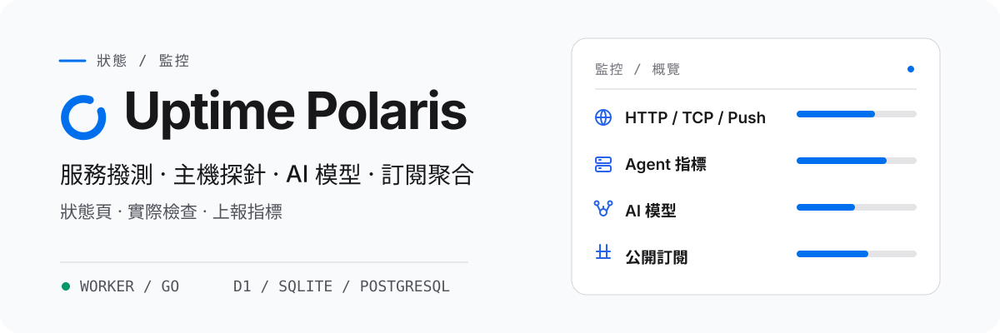

<div align="center">

<picture>
  <source media="(prefers-color-scheme: dark)" srcset="assets/readme/overview-zh-HK-dark.svg">
  <source media="(prefers-color-scheme: light)" srcset="assets/readme/overview-zh-HK-light.svg">
  
</picture>

<a href="README.md">English</a> · <a href="README-zh-CN.md">简体中文</a> · <a href="README-zh-TW.md">繁體中文（台灣）</a> · <strong>繁體中文（香港）</strong> · <a href="README-ja-JP.md">日本語</a> · <a href="README-ko-KR.md">한국어</a> · <a href="README-fr-FR.md">Français</a> · <a href="README-pt-BR.md">Português (Brasil)</a> · <a href="README-ru-RU.md">Русский</a>

# Uptime Polaris

多合一自架監控與狀態頁，整合服務撥測、主機探針、AI 模型監控與公開狀態訂閱。<br>
支援 Cloudflare Workers 與 Go 雙後端，內建公開狀態頁與管理後台，介面支援 9 種語言。

<p>
  <a href="https://developers.cloudflare.com/workers/"></a>
  <a href="backends/go/README.md"></a>
  <a href="frontend/README.md"></a>
  <a href="https://github.com/XingLingQAQ/Polaris-Agent"></a>
  <a href="docs/configuration.md"></a>
</p>

<p><a href="#功能">功能</a> · <a href="#後端選擇">後端選擇</a> · <a href="#快速部署">快速部署</a> · <a href="#主機探針">主機探針</a> · <a href="#文件">文件</a></p>

</div>

## 功能

- **服務與心跳監控**：支援 HTTP、TCP 與 Push 被動心跳，可附加 SSL 憑證、網域到期與 DNS 檢查；Go 後端額外原生支援 UDP、ICMP、DNS、TLS 與 WebSocket，內網服務可交由 Agent 代理探測。
- **可訂閱擴充監控**：支援訂閱其他站台的公開網站狀態與模型狀態並彙總展示。預設接入[官方訂閱儲存庫](https://github.com/XingLingQAQ/UptimePolaris-Subscriptions)（內建 Uptime Kuma、Polaris、Statuspage、JSON 等範本），也可加入第三方儲存庫或匯入自訂 JSON 描述檔。
- **主機探針**：搭配 Rust 撰寫的輕量探針 [polaris-agent](https://github.com/XingLingQAQ/Polaris-Agent)（支援 Linux / macOS / Windows 及 Docker），採集 CPU、記憶體、磁碟、負載、網絡等指標，支援資源閾值告警與機器比較。
- **AI 模型監控**：支援 OpenAI Chat Completions、OpenAI Responses、Anthropic Messages 與 Gemini 協定（相容中轉閘道與本機模型），支援從通路匯入模型、自訂請求參數與獨立展示頁。
- **多公開頁與主題**：提供監控頁（`/`）、機器頁（`/servers`）與 AI 模型頁（`/ai`），支援按需開關、綁定獨立網域、維護視窗切換以及安裝第三方主題包。
- **多通路告警**：支援 Telegram、飛書、Slack、Discord、Webhook、Apprise 與 Server醬，支援依全域規則或指定通路分發，訊息支援 9 種語言。

## 後端選擇

兩種後端共用同一套前端介面與 `/admin` 管理入口，依部署環境任選其一：

| | Cloudflare Worker | Go |
| --- | --- | --- |
| 執行方式 | Cloudflare Workers | 自有伺服器 / Docker |
| 資料庫 | D1 或 PostgreSQL | SQLite 或 PostgreSQL |
| 直接探測協定 | HTTP、TCP（UDP、ICMP 透過 Agent） | HTTP、TCP、UDP、ICMP、DNS、TLS、WebSocket |
| 最短檢查間隔 | 60 秒 | 5 秒 |
| 大規模分批 | 選用 Cloudflare Queue | 行程內常駐排程 |
| 主題儲存 | R2（選用） | 本機資料目錄 |

詳細差異見[選擇後端](docs/backends.md)。

## 快速部署

### Cloudflare Workers

1. Fork 本儲存庫，在 Cloudflare 主控台透過 **Workers & Pages → Create application → GitHub** 匯入，建置指令填 `npm run build`，部署指令填 `npm run deploy`。
2. 部署後開啟 `/setup`，依頁面檢查提示在 Worker 的 **Settings** 加入必要設定：
   - KV 綁定 `CONFIG`
   - Analytics Engine 綁定 `UPTIME`
   - Secret `ADMIN_TOKEN`（隨機長字串）
   - 選用：D1 綁定 `DB`（未綁則使用 PostgreSQL）、R2 綁定 `THEMES`（第三方主題）、Queue 綁定 `CHECK_QUEUE`（分批檢查）
3. 回到 `/setup` 完成資料庫驗證與管理員初始化。

也可以點擊下方按鈕直接部署（會建立獨立儲存庫，非 Fork）：

[](https://deploy.workers.cloudflare.com/?url=https://github.com/XingLingQAQ/UptimePolaris)

手動部署、自訂網域與 PostgreSQL 移轉見[部署指南](docs/deployment.md)。

### Go 自架

從 [Releases](https://github.com/XingLingQAQ/UptimePolaris/releases) 下載對應平台的程式後啟動：

```sh
chmod +x polaris   # Linux / macOS
./polaris --data-dir ./data
```

```powershell
.\polaris.exe --data-dir .\data
```

預設監聽 `127.0.0.1:8080`，啟動後開啟 `/setup`，用啟動日誌 `setup_key` 欄位中的初始化金鑰建立管理員。Docker 部署可直接參考 [`backends/go/compose.yaml`](backends/go/compose.yaml)，完整參數、環境變數與後台自動更新見 [Go 後端文件](backends/go/README.md)。

## 主機探針

登入 `/admin` 後進入 **Agent 管理** 新增機器，依提示複製對應平台的安裝指令並在目標機器執行即可。安裝後透過 `pa` 指令管理：

```sh
pa status
pa restart
pa logs -f
pa update
```

詳細設定、遠端指令與解除安裝方式見 [Agent 手冊](docs/agents.md)。

## 文件

| 文件 | 說明 |
| --- | --- |
| [選擇後端](docs/backends.md) | Worker 與 Go 後端能力對比 |
| [部署指南](docs/deployment.md) | Cloudflare 部署、網域、PostgreSQL 與 D1 移轉 |
| [Go 後端](backends/go/README.md) | 啟動參數、Docker、後台更新與資料移轉 |
| [使用手冊](docs/usage.md) | 監控設定、Push 心跳、公開頁、維護視窗與安全 |
| [訂閱指南](docs/subscriptions.md) | 訂閱儲存庫、自訂介面描述檔與同步機制 |
| [AI 模型監控](docs/ai-monitoring.md) | 通路協定、批次匯入、展示頁與金鑰管理 |
| [Agent 手冊](docs/agents.md) | 探針安裝、管理、設定與解除安裝 |
| [通知指南](docs/notifications.md) | 告警通路、路由規則與投遞記錄 |
| [Worker Queue](docs/queue.md) | Worker 佇列分批檢查設定 |
| [主題指南](docs/themes.md) | 第三方主題安裝、設定與開發 |
| [設定參考](docs/configuration.md) | 綁定、環境變數與後台設定項 |
| [API 參考](docs/api.md) | 介面說明與驗證方式 |
| [維運指南](docs/operations.md) | 升級、備份還原與資料保留 |
| [常見問題](docs/troubleshooting.md) | 故障排查 |

## 友情連結

[LinuxDo](https://linux.do/)

## 授權

基於 [MIT License](LICENSE) 開源。
